# Real-Time Purchase Trend Dashboard (Problem Statement #21)
### Big Data Analytics (BDA) Capstone Project

[](https://www.python.org/)
[](https://kafka.apache.org/)
[](https://hadoop.apache.org/)
[](https://hadoop.apache.org/docs/current/hadoop-mapreduce-client/hadoop-mapreduce-client-core/MapReduceTutorial.html)
[](https://fastapi.tiangolo.com/)

---

## 1. Problem Statement & Motivation

> **Problem Statement 21:**
> *Category managers currently review sales trends weekly, so they miss same-day shifts in product popularity that could inform inventory and promotion decisions.*
>
> **Objective:**
> *Stream purchase transactions via Kafka, store on HDFS, and generate a live dashboard showing the top 20 products by units sold in the trailing 60 minutes, refreshed every 5 minutes.*
>
> **Dataset:** Instacart Market Basket Analysis dataset.  
> **Tech Stack:** Kafka, Hadoop HDFS, MapReduce, live dashboard.

### The Business Challenge:
Traditional retail and e-commerce analytics rely on overnight batch ETL or weekly reports. In fast-moving grocery categories (produce, beverages, snacks, dairy), flash sales, viral promotions, weather spikes, or supply interruptions cause **intra-day velocity spikes**. A category manager reviewing data on a weekly schedule cannot restock shelves or adjust dynamic pricing before stock-outs occur.

### The Solution:
An end-to-end Big Data streaming and distributed batch aggregation pipeline that:
1. Streams continuous Instacart purchase transactions via **Apache Kafka**.
2. Persists streaming transaction events in time-partitioned **Hadoop HDFS** storage blocks (`year/month/day/hour`).
3. Executes a distributed **Hadoop MapReduce** job filtering the **trailing 60-minute window**, grouping by product, and aggregating units sold and total revenue.
4. Orchestrates a **5-minute recurring refresh cycle** (with immediate on-demand trigger capability).
5. Serves an executive-grade **Live Dashboard** with instant rank-shift alerts, velocity tracking, and promotion injection simulation.

---

## 2. System Architecture

```mermaid
flowchart LR
    subgraph Data Layer
        A[Instacart Dataset<br/>Market Basket Analysis] --> B[Kafka Streaming<br/>Producer]
    end

    subgraph Ingestion & Storage Layer
        B -->|Topic: instacart-transactions| C[Apache Kafka Broker<br/>Port 9092]
        C -->|Consumer Micro-Batches| D[Hadoop HDFS<br/>Partitioned Storage]
        D -->|/data/instacart_transactions/year=...| E[(HDFS Block Sink)]
    end

    subgraph Computation Layer
        E -->|Trailing 60-Min Input Split| F[Hadoop MapReduce Engine]
        F -->|Map: Filter 60m & Emit Key-Val| G[Shuffle & Sort]
        G -->|Reduce: Sum Units & Top 20| H[HDFS Output Sink<br/>/output/trailing_60min/top20.json]
    end

    subgraph Serving & Visualization Layer
        H --> I[FastAPI Backend Server<br/>Port 8000]
        I -->|REST APIs & SSE Streams| J[Live Web Dashboard<br/>Category Manager UI]
        K[5-Minute Scheduler Daemon] -->|Triggers Every 300s| F
    end
```



---

## 3. Directory Structure

```
BDA/
├── backend/
│   ├── app.py                      # FastAPI web server, REST endpoints & SSE streaming
│   └── pipeline_coordinator.py     # Master coordinator orchestrating Kafka, HDFS & MR
├── dataset/
│   ├── products_catalog.py         # Authentic Instacart products, aisles, departments & prices
│   ├── sample_data.py              # Real-time transaction generator & trailing-window seeder
│   └── download_kaggle.py          # Kaggle Instacart dataset loader helper
├── docker/
│   └── docker-compose.yml          # Apache Kafka, Zookeeper, Hadoop NameNode & DataNode
├── frontend/
│   ├── index.html                  # Executive Live Dashboard UI
│   ├── styles.css                  # Dark glassmorphic design system & micro-animations
│   └── app.js                      # Chart.js visualizations, SSE live feed, countdown ticker
├── hdfs_layer/
│   └── hdfs_manager.py             # HDFS partitioned storage manager & block metadata
├── kafka_pipeline/
│   ├── broker_simulator.py         # Dual-mode message broker & Kafka cluster connector
│   ├── producer.py                 # Real-time transaction streaming producer with flash surge
│   └── consumer.py                 # Kafka consumer writing micro-batches to HDFS
├── mapreduce/
│   ├── mapper.py                   # Hadoop Streaming Mapper (filters trailing 60m, emits TSV)
│   ├── reducer.py                  # Hadoop Streaming Reducer (aggregates units, outputs Top 20)
│   ├── job_runner.py               # MapReduce orchestrator & Hadoop cluster job runner
│   └── java/                       # Enterprise Java MapReduce source & Maven POM
│       ├── pom.xml
│       └── src/main/java/org/bda/Top20ProductsMR.java
├── storage/
│   ├── hdfs/                       # Simulated/Mounted HDFS partitioned directories
│   │   ├── data/instacart_transactions/
│   │   └── output/trailing_60min/
│   └── mapreduce_job_history.json  # Audit log of executed MapReduce jobs
├── run_pipeline.py                 # Master one-click pipeline launcher
├── test_pipeline.py                # End-to-end automated unit & integration test suite
├── requirements.txt                # Python dependencies
└── README.md                       # Complete documentation & project guide
```

---

## 4. Quick Start (Zero-Configuration Local Run)

The project includes an intelligent dual-mode architecture that runs seamlessly on Windows, macOS, or Linux out of the box without requiring external cluster installations, while also providing full native Docker cluster support!

### Step 1: Install Requirements
```bash
pip install -r requirements.txt
```

### Step 2: Run End-to-End Test Suite
```bash
python test_pipeline.py
```
*Validates dataset generator, Kafka producer/consumer, HDFS partitioned writes, MapReduce Top 20 calculation, and 5-minute scheduler.*

### Step 3: Launch the Master Pipeline
```bash
python run_pipeline.py
```

### Step 4: Access the Live Dashboard
Open your browser and navigate to:
```
http://localhost:8000
```
Interactive API Documentation is available at:
```
http://localhost:8000/docs
```

---

## 5. Running with Full Apache Kafka & Hadoop Cluster (Docker)

If you have Docker Desktop installed and want to run the pipeline against a full, distributed Apache Kafka and Hadoop cluster:

### Step 1: Spin up the Cluster Containers
```bash
cd docker
docker-compose up -d
```
This launches:
- **Apache Zookeeper** on port `2181`
- **Apache Kafka Broker** on port `9092`
- **Hadoop NameNode** on port `9870` (Web UI) and port `9000` (HDFS RPC)
- **Hadoop DataNode** on port `9864`

### Step 2: Verify Kafka Topic Creation
```bash
docker exec -it bda-kafka kafka-topics --create \
  --bootstrap-server localhost:9092 \
  --replication-factor 1 \
  --partitions 3 \
  --topic instacart-transactions
```

### Step 3: Run Hadoop Streaming MapReduce Job Manually
```bash
hadoop jar $HADOOP_HOME/share/hadoop/tools/lib/hadoop-streaming.jar \
  -input /data/instacart_transactions/*/*/*/*/*.jsonl \
  -output /output/trailing_60min/run_$(date +%s) \
  -mapper "python3 mapreduce/mapper.py 60" \
  -reducer "python3 mapreduce/reducer.py 20"
```

### Step 4: Compile and Run Java MapReduce Job
```bash
cd mapreduce/java
mvn clean package
hadoop jar target/top20-mapreduce-1.0.0.jar org.bda.Top20ProductsMR \
  /data/instacart_transactions \
  /output/trailing_60min \
  60
```

---

## 6. How the MapReduce Job Works

### Mapper (`mapreduce/mapper.py`)
- Reads raw transaction JSON records from HDFS.
- Evaluates the transaction timestamp against the trailing 60-minute cutoff:
  $$\text{cutoff\_epoch} = \text{current\_epoch} - 3600$$
- If $\text{epoch} \ge \text{cutoff\_epoch}$, emits key-value pair:
  ```tsv
  product_id    quantity    product_name    department    aisle    total_price
  ```

### Shuffle & Sort
- Hadoop MapReduce groups all occurrences of the same `product_id` together.

### Reducer (`mapreduce/reducer.py`)
- Aggregates the total units sold and revenue per `product_id`:
  $$\text{Units Sold} = \sum \text{quantity}$$
  $$\text{Total Revenue} = \sum \text{total\_price}$$
- Sorts all aggregated products descending by units sold.
- Selects the **Top 20** products.
- Computes volume share percentage and rank.
- Emits formatted JSON persisted to HDFS: `/output/trailing_60min/top20_latest.json`.

---

## 7. Live Dashboard Features for Category Managers

1. **Top 20 Leaderboard**: Ranks 1 to 20 with rank change indicators, medal badges for Top 3, volume share progress bars, and average prices.
2. **Department Filter**: Filter rankings instantly by *Produce*, *Dairy & Eggs*, *Beverages*, *Snacks*, *Bakery*, *Meat & Seafood*, or *Pantry*.
3. **Minute-by-Minute Velocity Shift Chart**: Real-time time-series chart showing popularity shifts over the trailing 60 minutes.
4. **5-Minute Countdown Clock**: Live visual countdown to the next scheduled MapReduce run.
5. **On-Demand MapReduce Execution**: "Run MapReduce" button with an animated 5-phase Hadoop progress tracker (Input Split $\rightarrow$ Map $\rightarrow$ Shuffle $\rightarrow$ Reduce $\rightarrow$ HDFS Commit).
6. **Flash Promotion Injection**: Category managers can trigger a 4x promotional surge on any product (e.g. *Organic Hass Avocado*) to observe intra-day ranking shifts in real time!
7. **Kafka & HDFS Inspector**: Live transaction stream ticker and HDFS partition file explorer.

---

## 8. REST API Reference

| Method | Endpoint | Description |
|---|---|---|
| `GET` | `/api/dashboard/summary` | Consolidated Top 20, KPIs, next refresh countdown, and pipeline health |
| `GET` | `/api/dashboard/top20` | Trailing 60-minute Top 20 products list |
| `GET` | `/api/dashboard/trends` | Minute-by-minute time-series sales trend for top products |
| `GET` | `/api/dashboard/catalog` | Product catalog for promotion simulation |
| `GET` | `/api/hdfs/status` | HDFS cluster metadata, blocks allocated, and capacity usage |
| `GET` | `/api/hdfs/files` | File hierarchy and partitions stored on HDFS |
| `GET` | `/api/mapreduce/history` | Execution log and counters for recent MapReduce jobs |
| `POST` | `/api/pipeline/mapreduce/trigger` | Manually triggers immediate MapReduce trailing aggregation |
| `POST` | `/api/pipeline/producer/surge` | Injects flash promotion multiplier for a specific product ID |
| `POST` | `/api/pipeline/producer/rate` | Adjusts Kafka transaction ingestion rate (tx/sec) |
| `GET` | `/api/stream/events` | Server-Sent Events (SSE) live feed of Kafka purchases and heartbeats |

---


